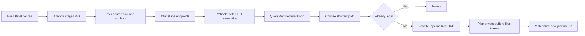

# Path Expansion Design

## Purpose

This document describes the design for a new path expansion transformation that legalizes data movement in [`ktdf.pipeline`](../src/Dialects/KTDF/KTDFOps.td) IR using an explicit architecture graph as the source of truth for legal routing. 

For examples of the before/after IR see test files in [`test/Transform/PathExpansion/`] directory.
---

## Goals

- introduce an architecture graph abstraction that represents legal hardware routing
- use that graph as the ground truth for path finding and legalization
- infer stage endpoints and anchor points from existing IR
- identify legal source-to-destination paths through the architecture
- select the shortest path in phase 1 (in future the path choosen may be driven by workload balancing, bandwidth utilization, and other requirements).
- rewrite pipelines by inserting intermediate stages and resources where needed
- rebuild dependency and private resources consistently
- leave already-legal pipelines unchanged

The design should also set up future extensions for:

- weighted or policy-driven path selection
- more general DAG legalization
- reusable materialization abstractions shared with other transforms

---

## Non-goals for Phase 1

Phase 1 intentionally does not attempt to solve every possible case.

Out of scope for phase 1:

- configurable architecture descriptions from input json file
- support for branching stage DAG legalization. Phase 1 will still analyze the full stage DAG, but rewriting is only supported when the stage topology is a single linear chain.
- general weighted path search beyond shortest path
- path expansion in nested pipelines where a single stage represents multiple "applicable_units"

---

## High-Level Pass Scope

A new dedicated path expansion pass will be added under [`src/Transform`](../src/Transform/).

The pass operates on [`mlir::ModuleOp`](../src/Transform/Passes.td:6) similarly to the existing transform passes in [`src/Transform/Passes.td`](../src/Transform/Passes.td).

At a high level the pass performs these steps:

1. build stage dependency structure for each pipeline
2. identify anchor, source, and sink stages
3. infer resource endpoints for those stages
4. query the architecture graph for legal paths
5. choose the shortest path
6. compare the chosen path with the currently realized stage path
7. if already legal, do nothing
8. otherwise construct a rewritten pipeline plan
9. rematerialize the affected pipeline region with new private resources, stages, and dependencies

---

## Core Design Principles

### 1. Architecture graph is the ground truth

The architecture graph is the authoritative description of legal routing and transfer semantics.

It answers:

- what resources exist
- which resources can connect directly
- what transfer unit (ie load/store unit) is used on a given hop
- whether a hop requires FIFO-based streaming (eg. lxlu->to-sfp)
- what FIFO kind applies to that hop
- what shortest path exists between two resources

### 2. Plan first, materialize last

The transformation should separate analysis from IR transformation:

- collect sufficient analysis and rewrite intent first
- mutate or rebuild IR only after the full plan is known

This is particularly important because [`ktdf.private`](../src/Dialects/KTDF/KTDFOps.td) cannot simply be expanded in place when result count and result types change.

### 3. Use structural planning separately from resource inference

[`PipelineTree`](../src/Analysis/PipelineTree.hpp) should be used for structural reasoning:

- stage DAG discovery
- topological ordering
- source and sink identification
- explicit rewritten dependency graph after inserted stages are added

However, resource inference and FIFO validation should still inspect MLIR stage contents directly. Note that the PipelineTree provides mapping from IR elements to tree nodes and vice-versa.

### 4. Keep future refactoring easy

A new path-expansion-specific materializer will be created, but it should intentionally mirror the structure of the current materializer implementation used by stage coarsening (where possible) so that future comparison and extraction of common code is straightforward.

---

## Architecture Graph

### Overview

The architecture graph models hardware routing at the resource level.

The graph has two main categories of nodes:

- memory-resource nodes
- compute-resource nodes

Examples relevant to phase 1 include:

- `HBM`
- `LX`
- `SFP`
- `PE`

Transfer units such as `L3LU`, `L3SU`, `LXLU`, and `LXSU` are not represented as graph nodes. They are represented as metadata attached to graph edges.

### Why resource-only nodes

Using resource-only nodes keeps pathfinding simple and matches the conceptual question the pass must answer:

- route data from source resource to destination resource

Transfer semantics are still preserved by attaching them directly to traversable edges.

This supports:

- concise visualization and dumping
- efficient neighbor traversal
- efficient shortest-path search
- direct lookup of per-hop rewrite requirements after a path is selected

### Graph properties

The graph implementation must support:

- concise and readable dumping
- efficient path search from one node to another
- efficient shortest-path search between two nodes

An adjacency-list representation is the recommended implementation.

### Proposed location

The graph should live under analysis rather than transform code:

- [`src/Analysis/ArchitectureGraph.hpp`](../src/Analysis/ArchitectureGraph.hpp)
- [`src/Analysis/ArchitectureGraph.cpp`](../src/Analysis/ArchitectureGraph.cpp)

This is preferable because the graph is a reusable analysis concept, even if phase 1 only uses it from path expansion.

### Node model

Recommended conceptual node model:

- `ResourceNodeKind`
  - `Memory`
  - `Compute`
- `ResourceId`
  - phase-1 built-in identifiers for resources such as `HBM`, `LX`, `SFP`, and potentially `PE`

The resource vocabulary should align with or be compatible with the existing enums in [`src/Dialects/KTDF/KTDFEnums.td`](../src/Dialects/KTDF/KTDFEnums.td).

### Edge model

Each directed edge carries local metadata. Use a unified edge record with optional fields.

Recommended conceptual fields:

- source resource
- destination resource
- edge kind
- transfer unit
- optional FIFO kind
- optional future cost

The meaning is:

- memory-to-memory edges typically use transfer semantics and do not require FIFO information
- memory-to-compute or compute-to-memory edges may require FIFO information
- future cost is reserved for weighted path selection later

### Edge categories

The document should treat edges semantically as two categories even though the implementation uses one unified record:

- storage transfer hops
- streaming hops

Examples:

- `HBM -> LX`
  - storage transfer hop
  - transfer unit `L3LU`
  - no FIFO
- `LX -> HBM`
  - storage transfer hop
  - transfer unit `L3SU`
  - no FIFO
- `LX -> SFP`
  - streaming hop
  - transfer unit `LXLU`
  - FIFO kind `lxlu-to-sfp`
- `SFP -> LX`
  - streaming hop
  - transfer unit `LXSU`
  - FIFO kind `sfp-to-lxsu`

### Built-in phase-1 Spyre graph

Phase 1 uses a built-in hardcoded Spyre architecture graph.

At minimum it should include:

- memory resources:
  - `HBM`
  - `LX`
- compute resources:
  - `SFP`
  - `PE`

A likely built-in phase-1 graph is:

- `HBM -> LX`
- `LX -> HBM`
- `LX -> SFP`
- `SFP -> LX`

Additionally for multi-path selection testing:

- `SFP -> PE`
- `PE -> LX`
- and or the reverse directions as appropriate for the intended route vocabulary

The presence of a longer alternate route through `PE` is specifically useful to validate shortest-path selection.

### Path search policy

Phase 1 path selection policy:

- discover legal paths through the graph (in debug mode report all legal paths for debugging purposes)
- choose the shortest path
- shortest path should be implemented with BFS on the resource graph

Later phases may replace this with weighted path search or policy-driven cost models.

### Required graph APIs

Recommended public APIs:

- `dump(raw_ostream &)`
- `getNeighbors(resource)`
- `findPath(source, destination)` or `findAllPaths(source, destination)` if needed
- `findShortestPath(source, destination)`
- `getEdgeInfo(source, destination)`

The pass should be able to ask:

- whether a direct hop is legal
- what transfer unit and FIFO kind apply to a given direct hop
- what shortest path exists between endpoints

---

## Stage DAG and Structural Analysis

### Use of PipelineTree

[`PipelineTree`](../src/Analysis/PipelineTree.hpp) is used as the stage-structure abstraction for path expansion planning.

It is specifically responsible for:

- discovering stages and their dependency DAG
- topological ordering
- source-stage and sink-stage discovery
- representing the rewritten final stage DAG after inserted stages are added

This is a good fit because [`StageNode`](../src/Analysis/PipelineTree.hpp:179) already stores dependency edges via [`StageNode::addDependency`](../src/Analysis/PipelineTree.hpp:193) and [`StageNode::getDependencies`](../src/Analysis/PipelineTree.hpp:196).

### Phase-1 DAG scope

Phase 1 will:

- analyze the full stage DAG
- reject pipelines whose stage topology is not a single linear chain

This means path expansion has a general DAG analysis front-end, but a restricted legalization back-end.

Branching DAGs should produce a diagnostic and be left unmodified.

### Source and sink discovery

Source and sink stage discovery should come from topological analysis of the stage DAG.

This is an important principle of the design:

- anchor stages are important
- but the start and end stages are equally important
- source and sink determination must not be hardcoded to particular stage positions or resource assumptions

In a linear chain:

- source stages are those with no incoming dependencies
- sink stages are those with no outgoing dependencies

These boundary stages are then inspected to infer starting and ending resource endpoints.

---

## Endpoint and Anchor Inference

### Anchor stages

Any stage with a single [`applicable_units`](../src/Dialects/KTDF/KTDFAttributes.td:94) is treated as an anchor point. Any stage with multiple units listed will be flagged as unsupported.

In phase 1, these are the primary explicit compute anchors.

If a stage has [`applicable_units`](../src/Dialects/KTDF/KTDFAttributes.td:94), the pass should treat that as an explicit statement about the compute resource associated with that stage.

### Start and end points

Source and sink stages are discovered from the stage DAG and then inspected for their data endpoints.

For example:

- a source stage with [`ktdf.data_transfer`](../src/Dialects/KTDF/KTDFOps.td) from an `HBM` memref implies a start resource of `HBM`
- a sink stage with [`ktdf.data_transfer`](../src/Dialects/KTDF/KTDFOps.td) to an `LX` memref implies an end resource of `LX`

### Stages without applicable_units

A hybrid rule is used:

- if a stage has [`applicable_units`](../src/Dialects/KTDF/KTDFAttributes.td:94), that defines the anchor resource
- otherwise infer endpoints from stage contents

Phase 1 should support inference for stages without explicit [`applicable_units`](../src/Dialects/KTDF/KTDFAttributes.td:94), including the middle compute stage if needed.

### Primary inference sources

The primary endpoint inference mechanism should inspect:

- [`ktdf.data_transfer`](../src/Dialects/KTDF/KTDFOps.td)
- memref memory-space types
- stage position in the DAG
- stage role as source, sink, or anchored compute stage

Memory endpoints can be inferred from memref memory space attributes such as [`#ktdf.memory_space<HBM>`](../src/Dialects/KTDF/KTDFAttributes.td:45).

### FIFO-based validation, not primary path inference

[`ktdf.read_from_fifo`](../src/Dialects/KTDF/KTDFOps.td:146) and [`ktdf.write_to_fifo`](../src/Dialects/KTDF/KTDFOps.td:197) should be used after endpoint inference as a validation layer.

This is important.

FIFO information should not be the primary path-selection mechanism. Instead it should validate the consistency of the inferred path and stage semantics.

Examples:

- a [`ktdf.read_from_fifo`](../src/Dialects/KTDF/KTDFOps.td:146) with `<"hbm-to-sfp", ...>` suggests the current stage consumes data from a producer side associated with `HBM` and should be consistent with DAG order
- the same FIFO also suggests that the consuming stage should include `SFP` as an applicable unit or inferred compute anchor
- a [`ktdf.write_to_fifo`](../src/Dialects/KTDF/KTDFOps.td:197) should similarly be consistent with the stage endpoint and downstream path

In phase 1 this should be treated as a validation and assertion step once endpoints and chain order have been inferred.

---

## Original Path Versus Desired Path

### Original path

The pass must infer the currently original path represented by the existing pipeline stages.

This is not merely the source and sink resources. It is the sequence of realized resource hops implied by:

- stage structure
- transfer endpoints
- FIFO connections
- anchor stages

### Desired path

The desired path is the shortest legal path returned by the architecture graph between the inferred endpoints.

### Idempotency

If the currently original path already matches the selected shortest legal path, the pass must not make any changes.

This applies to already-legal inputs.

The pass should preserve IR unchanged in that case rather than rewriting it into a normalized alternative form.

---

## Legalization Strategy

### Overview

When the original path does not match the selected shortest legal path, the pass legalizes the pipeline by:

- rewriting existing transfer stages where appropriate
- preserving anchored compute stages where possible
- inserting intermediate transfer stages for missing hops
- allocating intermediate buffers if the chosen path introduces memory resources not represented in the current stages
- allocating FIFO slots for streaming hops
- rebuilding synchronization around the new stage DAG

### Example from basic.mlir

Input shape:

- stage 1 transfers directly from `HBM` to FIFO intended for `SFP`
- stage 2 computes on `SFP`
- stage 3 transfers directly from FIFO back to `HBM`

Architecture graph says legal path is:

- `HBM -> LX -> SFP`
- `SFP -> LX -> HBM`

Therefore legalization should:

- change first transfer stage into `HBM -> LX`
- insert intermediate `LX -> SFP` stage
- preserve the anchored compute stage but change its FIFO kinds if needed
- insert `SFP -> LX` stage
- change final transfer stage into `LX -> HBM`

Result:

- 3 stages become 5 stages

### Partial expansion

The pass must also support partially expanded inputs.

Example:

- one side is already legalized, such as `HBM -> LX -> SFP`
- the other side still contains a direct illegal `SFP -> HBM`

In this case the pass should only expand the side that still requires legalization.

---

## Rewrite Planning Model

The pass should build a modification plan before IR rematerialization.

Recommended conceptual plan contents:

- pipeline being modified
- original stage order
- source stage, sink stage, anchor stages
- inferred stage summaries
- original resource path
- selected architecture path
- stage insertion and replacement plan
- new private resource specifications
- final rewritten stage DAG

### Stage Summaries

Each original stage should have a summary record containing the information needed by the planner.

Suggested summary contents:

- original stage op
- corresponding [`StageNode`](../src/Analysis/PipelineTree.hpp:179)
- whether [`applicable_units`](../src/Dialects/KTDF/KTDFAttributes.td:94) exists
- inferred anchor resource if any
- inferred input endpoints
- inferred output endpoints
- transfer operations in source order
- FIFO validation findings
- stage classification:
  - transfer only
  - compute containing

### Final DAG as source of truth

After deciding which stages are preserved, replaced, or inserted, the planner should produce the final stage DAG explicitly on a modified [`PipelineTree`](../src/Analysis/PipelineTree.hpp).

This final DAG is the single source of truth for synchronization during materialization.

Old token identities are ignored.

---

## Private Region and Resource Allocation

### Why rematerialize private

[`ktdf.private`](../src/Dialects/KTDF/KTDFOps.td) cannot simply be expanded in place when new buffers, FIFO slots, or tokens are added because the result signature changes.

Therefore phase 1 should:

- create a new corresponding private region
- rematerialize the needed private resources
- update all stage uses to reference the new private results
- remove or replace the old pipeline region as part of full pipeline rematerialization

### Buffer allocation

If the chosen path includes additional memory resources not represented by the existing set of stages, the pass must allocate buffers in those intermediate resources.

For the baseline example, path expansion creates new `LX` buffers. 

Expected pattern:

- one `LX` buffer per logical tensor flow that must be staged through `LX`
- for the basic example this likely means:
  - one intermediate `LX` buffer for input A
  - one intermediate `LX` buffer for input B
  - one intermediate `LX` buffer for output C

The type, shape and size should be derived from:

- the transferred slice shape
- the element type
- the intermediate memory space

For example the `HBM` memref in the `HBM` -> `SFP` data transfer specifies the size/shape/type of the `LX` buffer that is being introduced in the middle.

### FIFO allocation

FIFO slots are allocated only for hops whose graph edge metadata requires them.

This choice should come from the architecture graph edge, not ad hoc pass logic.

Examples:

- `LX -> SFP` uses `lxlu-to-sfp`
- `SFP -> LX` uses `sfp-to-lxsu`

### Tokens

The planner should not preserve old token identities.

Instead:

- compute the final stage DAG
- identify dependency edges that require tokens
- materialize fresh tokens from the new [`ktdf.private`](../src/Dialects/KTDF/KTDFOps.td) based on that DAG

---

## Materialization Design

### Overall decision

Phase 1 uses a new path-expansion-specific materializer.

It should not reuse the current materializer class directly, and phase 1 should not attempt a broad shared-materializer refactor.

However, the new materializer should be intentionally shaped similarly to the existing implementation so that future refactoring is straightforward.

### Required preparatory rename

The current generic-looking materializer in:

- [`src/Transform/PipelineTree/Materializer.hpp`](../src/Transform/PipelineTree/Materializer.hpp)
- [`src/Transform/PipelineTree/Materializer.cpp`](../src/Transform/PipelineTree/Materializer.cpp)

should be renamed to a stage-coarsening-specific name.

For example:

- `src/Transform/StageCoarsening/StageCoarseningMaterializer.hpp`
- `src/Transform/StageCoarsening/StageCoarseningMaterializer.cpp`
- class `StageCoarseningMaterializer`

This rename is a clarifying refactor in support of path expansion and future comparison. It is not a broader redesign of shared materialization.

### Path expansion materializer location

Recommended new files:

- [`src/Transform/PathExpansion/PathExpansionMaterializer.hpp`](../src/Transform/PathExpansion/PathExpansionMaterializer.hpp)
- [`src/Transform/PathExpansion/PathExpansionMaterializer.cpp`](../src/Transform/PathExpansion/PathExpansionMaterializer.cpp)

### Structural similarity requirement

The new materializer should mirror the stage-coarsening materializer structure as much as practical.

Use similar function names and call flow, such as:

- `materialize`
- `getMaterializedOp`
- `materializeTreeNode`
- `materializeChildren`
- `materializeLoopNode`
- `materializePipelineNode`
- `materializeStageNode`
- `materializePrivateNode`

Class member naming and order should also be kept similar where practical.

This has two advantages:

- easier implementation comparison
- easier future extraction of common base functionality

### Materialization algorithm

The path expansion materializer should:

1. traverse the modified [`PipelineTree`](../src/Analysis/PipelineTree.hpp)
2. recreate the pipeline structure
3. materialize a new private region
4. build a mapping from planned private resources to new SSA values
5. generate fresh tokens from the final stage DAG and link them to depends_in/out clauses of applicable stages.
6. materialize preserved stage bodies where possible
7. synthesize new stage bodies for inserted transfer stages
8. rewrite stage bodies that must change endpoints or FIFO types
9. erase or replace the original pipeline after the new one is constructed

### Template usage

Unlike stage coarsening, the new materializer may rely less on template operations for some inserted stages.

Inserted stages may require synthetic stage bodies built from plan records rather than pure cloning.

However, preserved stages should still be cloned from the original where practical.

---

## Pass Algorithm

The phase-1 pass algorithm should look like this.

### Step 1: Identify candidate pipelines

Walk pipelines in the module.

For each [`ktdf.pipeline`](../src/Dialects/KTDF/KTDFOps.td):

- build a [`PipelineTree`](../src/Analysis/PipelineTree.hpp)
- derive the stage dependency DAG
- reject non-linear topologies for rewriting

### Step 2: Discover structural anchors

Using the stage DAG:

- identify source stages
- identify sink stages
- identify explicit anchor stages with [`applicable_units`](../src/Dialects/KTDF/KTDFAttributes.td:94)

### Step 3: Infer stage resources

For each stage:

- inspect [`ktdf.data_transfer`](../src/Dialects/KTDF/KTDFOps.td) endpoints
- inspect memref memory spaces
- inspect stage body to classify transfer-only versus compute-containing
- infer anchor resource if no explicit [`applicable_units`](../src/Dialects/KTDF/KTDFAttributes.td:94) is present and inference is possible

### Step 4: Validate with FIFO semantics

Inspect:

- [`ktdf.read_from_fifo`](../src/Dialects/KTDF/KTDFOps.td:146)
- [`ktdf.write_to_fifo`](../src/Dialects/KTDF/KTDFOps.td:197)

Use them to validate:

- endpoint consistency
- stage order consistency with the DAG
- compute anchor compatibility

### Step 5: Infer original path

Derive the currently realized resource-hop chain from the source stage through anchor stages to the sink stage.

### Step 6: Query architecture graph

For each required segment between inferred endpoints:

- query legal route
- choose shortest path using BFS
- fail if no legal path exists

### Step 7: Compare and decide

If original path already matches chosen path:

- do nothing

Otherwise:

- build a legalization plan

### Step 8: Build Modified PipelineTree

Create a modified structural plan by manipulating or rebuilding [`PipelineTree`](../src/Analysis/PipelineTree.hpp):

- preserve stages that remain valid
- replace stages whose endpoints must change (unmaterialized nodes with the replaced stage acting as the template op)
- insert new intermediate stages (a side map could link these new stages with stage summaries created earlier if needed for materialization)
- rebuild stage dependency edges as the final explicit DAG

### Step 9: Build private-resource plan

Determine:

- new intermediate memrefs
- new FIFO slots

Note, no need to track new tokens since they will be materialized based on stage dependency edges.

### Step 10: Materialize new IR

Use the new path-expansion-specific materializer to:

- rematerialize pipeline
- rematerialize private
- rebuild stage bodies and dependencies

---

## Repository Layout

Recommended new and updated files.

### New analysis files

- [`src/Analysis/ArchitectureGraph.hpp`](../src/Analysis/ArchitectureGraph.hpp)
- [`src/Analysis/ArchitectureGraph.cpp`](../src/Analysis/ArchitectureGraph.cpp)

### New transform files

- [`src/Transform/PathExpansion.cpp`](../src/Transform/PathExpansion.cpp)
- [`src/Transform/PathExpansion/PathExpansionMaterializer.hpp`](../src/Transform/PathExpansion/PathExpansionMaterializer.hpp)
- [`src/Transform/PathExpansion/PathExpansionMaterializer.cpp`](../src/Transform/PathExpansion/PathExpansionMaterializer.cpp)

Optional helper files if implementation becomes cleaner with them:

- [`src/Transform/PathExpansion/Planner.hpp`](../src/Transform/PathExpansion/Planner.hpp)
- [`src/Transform/PathExpansion/Planner.cpp`](../src/Transform/PathExpansion/Planner.cpp)

### Existing files to update

- [`src/Transform/Passes.td`](../src/Transform/Passes.td)
- [`src/Transform/CMakeLists.txt`](../src/Transform/CMakeLists.txt)
- [`src/Analysis/CMakeLists.txt`](../src/Analysis/CMakeLists.txt)

### Existing files to rename

Rename the current stage-coarsening materializer files to clarify ownership:

- [`src/Transform/PipelineTree/Materializer.hpp`](../src/Transform/PipelineTree/Materializer.hpp)
- [`src/Transform/PipelineTree/Materializer.cpp`](../src/Transform/PipelineTree/Materializer.cpp)

to stage-coarsening-specific names.

---

## Testing Plan

The tests should focus primarily on intended path-expansion behavior rather than mostly invalid scenarios.

### Baseline golden test

- input: [`test/Transform/PathExpansion/basic.mlir`](../test/Transform/PathExpansion/basic.mlir)
- expected: [`test/Transform/PathExpansion/basic.out.mlir`](../test/Transform/PathExpansion/basic.out.mlir)

This validates:

- HBM to SFP expansion through LX
- SFP to HBM expansion through LX
- intermediate buffer allocation in LX
- FIFO kind changes
- stage insertion
- dependency rewiring

### Test A: LX boundary variant

Create a variant where:

- the first stage reads from `LX` instead of `HBM`
- the final stage writes back to `LX`

This validates:

- source and sink discovery from DAG boundaries
- endpoint inference is not hardcoded to HBM

### Test B: partially expanded case

Create a variant where the input is already partially legalized.

Examples:

- `HBM -> LX -> SFP` already exists, but `SFP -> HBM` still needs expansion
- or the reverse

This validates:

- selective expansion
- pass only inserts the missing legalization path
- already-legal subpath remains unchanged

### Test C: inferred middle-stage anchor

Create a variant where the middle compute stage has no [`applicable_units`](../src/Dialects/KTDF/KTDFAttributes.td:94).

The pass must:

- infer the stage anchor from stage contents
- use FIFO-based validation to confirm the inferred anchor is consistent

### Test D: already-legal no-op case

Create a variant whose original path already matches the shortest legal architecture path.

The pass should:

- leave the IR unchanged

### Test E: shortest path among multiple candidates

The built-in graph should include a longer alternative route, for example one involving `PE`.

A test should confirm:

- the pass chooses the shortest route
- not merely any legal route

This may be covered by a variant of [`basic.mlir`](../test/Transform/PathExpansion/basic.mlir) if the graph includes a longer `SFP -> PE -> LX` style alternative.

### Negative tests

Negative tests are still useful, but they are not the primary emphasis for phase 1.

A small number of negative tests may later be added for:

- branching DAG rejection
- no legal route
- inconsistent FIFO validation

---

## Diagnostics and Assertions

The pass should provide clear diagnostics for unsupported or inconsistent situations.

Examples include:

- branching stage DAG not supported in phase 1
- unable to infer source or sink resource
- unable to infer anchor resource for a compute-containing stage
- no legal architecture path between inferred endpoints
- FIFO direction inconsistent with inferred stage order
- FIFO semantics inconsistent with stage anchor
- partially inferred or contradictory stage endpoint information

---

## Future Follow-Ups

After phase 1 lands, likely follow-up work includes:

### 1. Shared materialization refactor

Once both stage coarsening and path expansion have sibling materializers with similar structure, compare them and extract common functionality into a shared base class or helper layer.

Likely shared areas:

- tree traversal materialization skeleton
- stage dependency to token mapping
- private rematerialization helpers
- value remapping helpers

### 2. Weighted path selection

Add cost-based path selection modes using the edge `cost` field.

Examples:

- shortest path
- load balancing
- congestion-aware routing
- policy-specific preference for certain compute paths

### 3. More general DAG legalization

Extend support from linear chains to branching stage DAGs.

### 4. Configurable architecture descriptions

Allow architecture graph construction from configuration or another representation instead of relying only on a hardcoded built-in model.

### 5. Broader validation coverage

Add more tests for invalid or ambiguous inputs once the core legalization path is stable.

---

## Mermaid Overview

---

## Final Phase-1 Decisions Summary

- dedicated path-expansion pass
- hardcoded built-in Spyre architecture graph
- architecture graph under analysis in [`src/Analysis`](../src/Analysis/)
- resource-only graph nodes
- edge-local metadata with optional FIFO and cost fields
- full DAG analysis but linear-chain-only rewrite support
- [`PipelineTree`](../src/Analysis/PipelineTree.hpp) used for structural planning and rewritten dependency DAG
- direct MLIR inspection for endpoint inference
- FIFO ops used primarily for validation after inference
- shortest path policy only
- no-op for already-legal shortest-path pipelines
- new path-expansion-specific materializer
- rename current materializer to stage-coarsening-specific naming
- design the new materializer to mirror stage-coarsening materializer structure for future refactoring